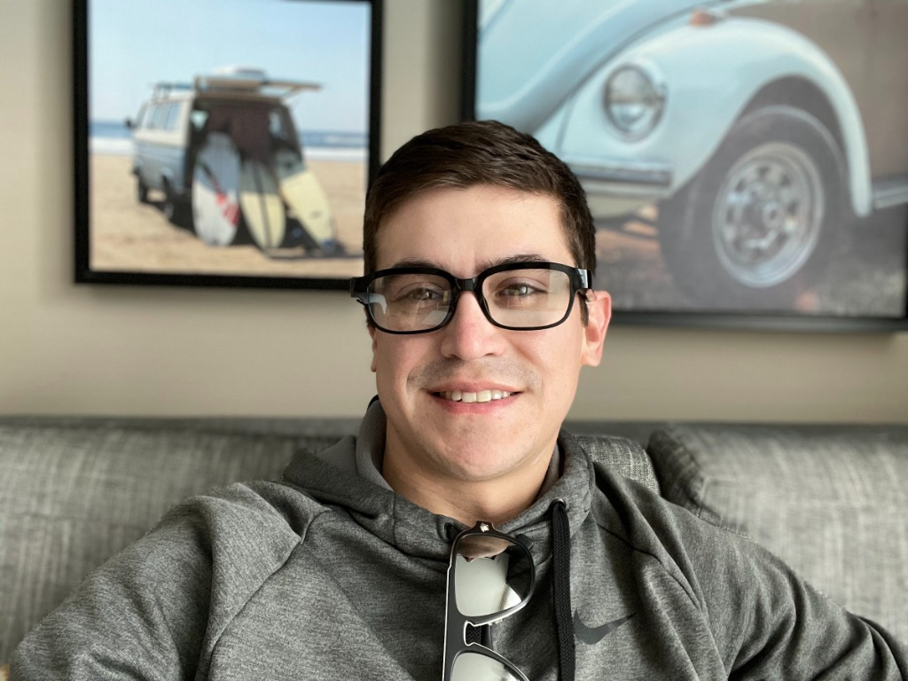

# ARIES Public Preview Beta (macOS)

[](https://buymeacoffee.com/andrewreynk)

A lightweight, 100% on-device Apple Silicon AI assistant built around a single embedded Metal `llama-server` engine, real-time voice I/O, and an Apple Human Interface Guidelines (macOS Glass & Vibrancy) interface.

## Included Stack
- **LLM + Vision + MTP**: Gemma 4 E2B IT 4-bit QAT (`llama.cpp` Apple Silicon Metal)
- **Speech-to-Text (ASR)**: NVIDIA Parakeet-TDT 0.6B v2 INT8 (`sherpa-onnx`)
- **Text-to-Speech (TTS)**: Phonon 31M Freya INT8 (`litert`)
- **Local RAG**: EmbeddingGemma 2 (270M) + SQLite
- **Rich UI**: Offline Mermaid.js diagrams, KaTeX LaTeX math, Highlight.js code blocks, Side-by-Side Live Preview Canvas, Sandboxed Code Runner, and First-Launch Graphical Model Auto-Downloader.

## Quick Start
```bash
python3 -m venv .venv
source .venv/bin/activate
pip install -r requirements.txt
./launch.sh
```
Or build the macOS `.app` bundle:
```bash
./scripts/build_mac_app.sh
```

## About the Creator



Hey, I’m Andrew. I spend my free time tinkering with local AI orchestration, native Apple/Android apps, and Raspberry Pi/ESP32 robotics. I’m not a corporate dev—just someone who loves pushing consumer hardware to its limits and building practical, open-source tools from scratch. If any of my projects, scripts, or experiments have helped you out or sparked an idea, buying me a coffee helps fund the next round of parts, compute, and late-night builds.

- [Buy Me a Coffee](https://buymeacoffee.com/andrewreynk)
- [YouTube (@andrewryanreynosa)](https://www.youtube.com/@andrewryanreynosa)
- [GitHub (@CyberMagician)](https://github.com/CyberMagician)
- [Kaggle (@andrewreynosa)](https://www.kaggle.com/andrewreynosa)
- [LinkedIn](https://www.linkedin.com/in/andrew-reynosa-9a7614118/)
